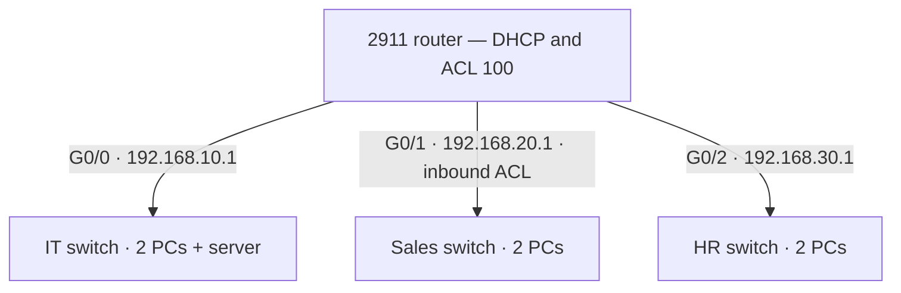
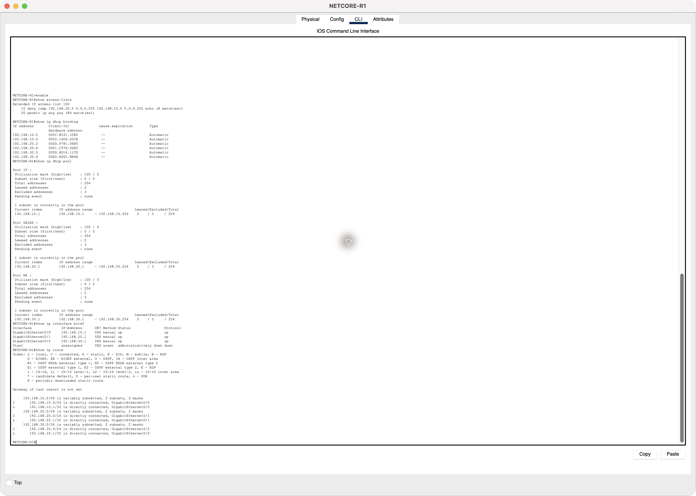
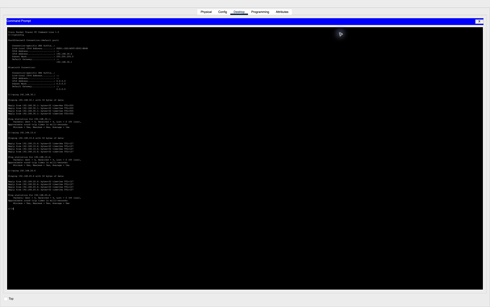

# NetCore: DHCP, routing and selective traffic filtering

Educational networking coursework by **Kelechi Alexander Ugoh / Thunderboy**, a cybersecurity analyst focused on AppSec. Evidence was captured on 9 October 2026; the coursework was submitted that evening. This is a simulated lab, not a client deployment or production-security assessment.

## Table of Contents

- [Project Overview](#project-overview)
- [Network Topology](#network-topology)
- [Tools and Technologies](#tools-and-technologies)
- [Configuration Steps](#configuration-steps)
- [Results and Findings](#results-and-findings)
- [Author](#author)
- [Limitations and publication boundary](#limitations-and-publication-boundary)

## Project Overview

Model IT, Sales and HR departments, assign addresses centrally and test a selective traffic rule without breaking required connectivity. 

## Network Topology

A Cisco 2911 router connects three Cisco 2960 switches. Each department has two DHCP PCs; IT also has a statically addressed HTTP/FTP server.



This diagram is an explanatory reconstruction, not a screenshot of the saved topology.

| Department | Network | Gateway | Recorded DHCP PCs |
| --- | --- | --- | --- |
| IT | 192.168.10.0/24 | 192.168.10.1 | .5 and .6 |
| Sales | 192.168.20.0/24 | 192.168.20.1 | .5 and .6 |
| HR | 192.168.30.0/24 | 192.168.30.1 | .5 and .6 |

The IT server uses 192.168.10.2. These are private addresses within a simulated exercise. Router DHCP pools supplied six bindings, and all three router interfaces were recorded up/up with connected routes.

## Tools and Technologies

- Cisco Packet Tracer simulation
- Cisco 2911 router and three Cisco 2960 switches (simulated devices)
- Six PCs and one IT server (simulated endpoints)
- IPv4 /24 addressing, router DHCP and connected routing
- Extended ICMP access-control list 100
- Command-line address/routing/ACL inspection, ping, HTTP and FTP lab tests

## Configuration Steps

This is a concise reconstruction from the final lab configuration and evidence, not a claim that the saved file has been reopened and reproduced.

1. Connect each departmental switch to its router interface, with two PCs per department and the server in IT.
2. Assign the router gateways `192.168.10.1/24`, `192.168.20.1/24` and `192.168.30.1/24`; enable the three interfaces.
3. Configure departmental DHCP pools; keep gateway/server addresses outside the dynamic allocations. Set the IT server to `192.168.10.2/24` with gateway `192.168.10.1`.
4. Enable the required HTTP and FTP lab services. Keep example account credentials out of publication.
5. Create ACL 100 and apply it inbound on Sales-facing `G0/1`, using the rule rationale below.
6. Check DHCP bindings, up/up interface states and connected routes, then test both permitted and denied paths in the results table.
7. Save the project. A fresh reopen/retest is still required before claiming saved-file reproducibility.

### ACL rationale

ACL 100 is applied inbound on the Sales-facing G0/1 interface:

```text
10 deny icmp 192.168.20.0 0.0.0.255 192.168.10.0 0.0.0.255 echo
20 permit ip any any
```

The rule targets Sales-originated ICMP echo requests to IT. It does not block all ICMP: echo replies returning from Sales can still support IT-initiated pings. The final permit retains HR connectivity and the required HTTP/FTP lab services. This is a narrow exercise policy, not comprehensive departmental isolation or least-privilege segmentation.

## Results and Findings

The live testing record matched all ten required outcomes:

| Source | Test | Recorded outcome |
| --- | --- | --- |
| IT PC1 | Ping Sales PC1 | 4/4 replies |
| IT PC1 | Ping HR PC1 | 4/4 replies |
| HR PC1 | Ping IT PC1 | 4/4 replies |
| HR PC1 | Ping Sales PC1 | 4/4 replies |
| Sales PC1 | Ping HR PC1 | 4/4 replies |
| Sales PC1 | Ping IT PC1 | 0/4 replies; gateway reported unreachable |
| Sales PC1 | IT server HTTP | Page loaded |
| Sales PC1 | IT server FTP | Fresh login and directory listing succeeded |
| HR PC1 | IT server HTTP | Page loaded |
| HR PC1 | IT server FTP | Fresh login and directory listing succeeded |

The router capture records eight deny matches, 84 permit matches and six DHCP leases at that moment. Counters are evidence of the captured session, not permanent performance or security metrics. Supplemental HR PC2 checks showed its gateway and departmental ping paths replying.

## Selected evidence for review

[Router interfaces, connected routes, DHCP pools/bindings and ACL counters](evidence/27_final_routes_interfaces.jpg)



[HR PC2 address and ping results](evidence/23_hr_pc2_pings.jpg)



These are unaltered lab captures. They show simulated addresses and device identifiers; no visible credentials or personal data are included. Open the full-sized files to read the command output.

## Lessons and AppSec connection

- Test the direction and message type of a rule, not just whether a ping fails. Blocking echo requests differs from blocking replies.
- Verify DHCP bindings, connected routes and interface state before treating a traffic failure as an ACL result.
- Combine positive and negative tests: a denied path alone cannot demonstrate that the intended allowed paths still work.
- Keep evidence scope precise. The same habit matters in application authorization testing: an observed outcome must match the actual actor, operation and resource boundary being assessed. This networking exercise itself is not an application penetration test.

## Limitations and publication boundary

The final Packet Tracer project was saved, but reopening and retesting that saved file remains unverified. The HTTP server still displays the default Cisco page; NetCore page branding was not implemented before submission. A complete topology screenshot is unavailable. HTTP and FTP are unencrypted lab requirements, and example accounts were used; this is not a recommended production design.

This repository contains an original case study and two inspected lab captures. It excludes the instructor walkthrough, assignment brief, submission archive, full report, raw Packet Tracer file and screenshots containing login history.

## Author

**Kelechi Alexander Ugoh / Thunderboy** — cybersecurity analyst focused on AppSec, alongside product development and visual design.

[Portfolio](https://thunderboy.vercel.app) · [Contact](https://thunderboy.vercel.app/contact)
